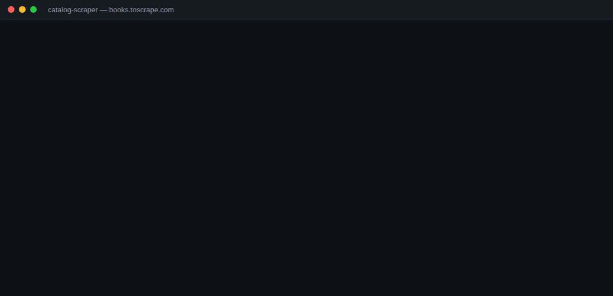
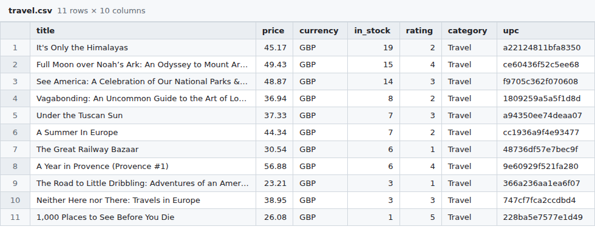

# catalog-scraper

[](https://github.com/breezy-development/catalog-scraper/actions/workflows/tests.yml) 

A small, production-style Python web scraper that crawls a product catalog and exports clean
**CSV, JSON or JSONL**. It targets [books.toscrape.com](https://books.toscrape.com), a sandbox
site built for scraping practice, so you can run every command below yourself.



The same structure (polite fetcher → pure parsers → exporters → CLI) is what I use for client
scrapers. Swapping in a different site means rewriting `parse.py` and keeping the rest.

## Features

- **Polite by default:** reads and obeys `robots.txt` (including `Crawl-delay`), waits 1 second
  between requests, sends an identifying User-Agent, and backs off on 429/5xx with retries.
- **Clean, typed output:** prices as numbers with an ISO currency code, star ratings as 1–5,
  stock counts as integers, absolute URLs. Columns are stable and documented below.
- **CSV, JSON or JSONL**, to a file or stdout. JSONL streams row by row, so long runs can be
  piped into other tools.
- **Filters:** category, minimum rating, page limit, row limit.
- **Resilient:** one broken product page is logged and skipped instead of killing the run;
  duplicate URLs are dropped.
- **Tested offline:** 23 tests run against saved HTML fixtures and mocked HTTP. No network needed.

## Quick start

```bash
git clone https://github.com/breezy-development/catalog-scraper.git
cd catalog-scraper
python -m venv .venv && source .venv/bin/activate
pip install -e .

catalog-scraper --list-categories
catalog-scraper --category travel --out travel.csv
catalog-scraper --category mystery --min-rating 4 --out mystery.json
catalog-scraper --limit 50 -f jsonl | jq .title
```

Requires Python 3.10+.

## Options

| Flag | Default | Meaning |
|---|---|---|
| `-c, --category` | all books | Category slug, e.g. `travel`, `historical-fiction` |
| `-o, --out` | stdout | Output file. The extension picks the format |
| `-f, --format` | from `--out`, else `csv` | `csv`, `json` or `jsonl` |
| `--max-pages N` | no limit | Stop after N listing pages (20 books each) |
| `--limit N` | no limit | Stop after N books |
| `--min-rating 0-5` | 0 | Keep only books with at least this many stars |
| `--delay S` | 1.0 | Seconds between requests (raised automatically if `robots.txt` asks) |
| `--list-categories` | | Print category slugs and exit |
| `-v, --verbose` | | Log every request |

## Output



| Column | Type | Example |
|---|---|---|
| `title` | text | It's Only the Himalayas |
| `price` | number | 45.17 |
| `currency` | ISO code | GBP |
| `in_stock` | integer | 19 |
| `rating` | 1–5 | 2 |
| `category` | text | Travel |
| `upc` | text | a22124811bfa8350 |
| `url` | URL | https://books.toscrape.com/catalogue/its-only-the-himalayas_981/index.html |
| `image_url` | URL | https://books.toscrape.com/media/cache/…jpg |
| `description` | text | “Wherever you go, whatever you do…” |

Real output from a run is in [`samples/`](samples/): `travel.csv` (11 books) and `poetry.json` (5 books).

## Project layout

```
src/catalog_scraper/
  fetch.py     PoliteFetcher: robots.txt, throttling, retries, encoding
  parse.py     pure functions: HTML in, dataclasses out (no network)
  scraper.py   crawl logic: categories, pagination, dedupe, filters
  export.py    CSV / JSON / JSONL writers
  cli.py       argparse entry point (`catalog-scraper`)
tests/         pytest suite with saved HTML fixtures
```

## Running the tests

```bash
pip install -e '.[dev]'
pytest
```

## Scraping responsibly

This project only scrapes a site that exists for scraping practice. For real projects I check
the site's terms and `robots.txt` first, prefer an official API when one exists, keep request
rates low, and do not collect personal data or anything behind a login.

## About

Built by Michael (Breezy Development) with AI-assisted development; every line is reviewed and
tested by a human before it ships.

## License

[MIT](LICENSE)
